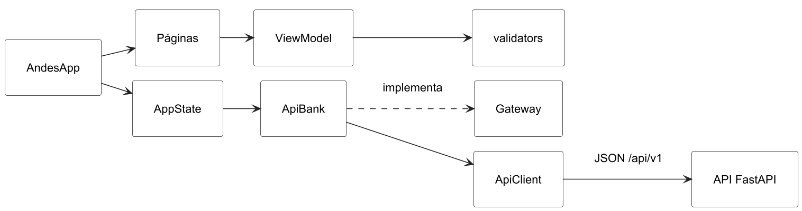

# AndesBank

Laboratorio de banca para SI-988 Soluciones Móviles II, de la Universidad Privada de Tacna, en el que la app corre en el emulador de Android y habla con un API propio. No es una entidad financiera, no está supervisada y no mueve dinero real.

## Requisitos

Debe verificar si cumple con la siguiente lista de requisitos previamente instalados y configurados en su computador.

La tabla es para Windows, donde `winget` ya viene en Windows 10 y 11, y si en PowerShell o en CMD el comando `winget --version` no responde, se usa el instalador de la misma fila.

| Herramienta | Cuándo | Dónde | Comando o página |
|---|---|---|---|
| Docker Desktop | Antes de levantar el servicio | PowerShell o CMD, y si no hay winget el instalador con doble clic | `winget install -e --id Docker.DockerDesktop` o https://docs.docker.com/desktop/setup/install/windows-install/ |
| Git | Antes de clonar, aunque si la carpeta ya está en el computador puede esperar hasta GitHub | PowerShell o CMD, o instalador con doble clic | `winget install -e --id Git.Git` o https://git-scm.com/download/win |
| Flutter 3.50.1 | Antes de la app, y no hace falta para el API | Navegador para el zip, PowerShell para descomprimir y Configuración de Windows para el Path | https://storage.googleapis.com/flutter_infra_release/releases/stable/windows/flutter_windows_3.50.1-stable.zip y https://docs.flutter.dev/install/manual |
| Android Studio | Antes de `flutter run`, para crear el emulador | Instalador de Windows con doble clic, porque no es un comando | https://developer.android.com/studio |
| Postman | Solo al repetir las peticiones, y no hace falta para levantar el servicio | Instalador con doble clic, porque no es un comando | https://www.postman.com/downloads/ |

Flutter se deja listo al descargar el zip en el navegador y descomprimirlo en PowerShell, en una carpeta que no lleve espacios.

```powershell
New-Item -ItemType Directory -Force -Path "$env:USERPROFILE\develop"
Expand-Archive -Path "$env:USERPROFILE\Downloads\flutter_windows_3.50.1-stable.zip" -DestinationPath "$env:USERPROFILE\develop"
```

El Path no se agrega con un comando, sino desde el buscador de Windows, en **Variables de entorno**, donde se edita Path del usuario, se agrega `%USERPROFILE%\develop\flutter\bin` y después se cierra la terminal para abrirla de nuevo. El detalle está en https://docs.flutter.dev/install/add-to-path.

Android Studio instala el SDK en su asistente, y en Device Manager se crea un dispositivo virtual que debe quedar encendido antes de `flutter run`.

Con Docker Desktop ya abierto desde el menú Inicio, esta comprobación se pega en PowerShell o en CMD.

```powershell
docker --version
flutter --version
```

El repositorio trae `mobile/` con la app Flutter, `backend/` con el API FastAPI, `postman/` con la colección y `.github/workflows/` con la integración continua, mientras la documentación de clase se entrega aparte y no viaja aquí.

## Levantar el servicio

Con Docker Desktop en marcha, en PowerShell o en CMD, desde la raíz del repositorio.

```bash
docker compose up --build
```

Cuando `/health` responda, el API queda en `http://127.0.0.1:8080`, con la documentación interactiva en `http://127.0.0.1:8080/docs`, y PostgreSQL escucha en el puerto `5432`, con base `andesbank`, usuario `andes` y clave `andes_local`.

`docker compose down` baja los contenedores y conserva los datos, mientras `docker compose down -v` borra el volumen y la próxima subida vuelve a sembrar las cuentas.

## Arquitectura de la app móvil

La app vive en `mobile/lib` y separa la pantalla del HTTP, de modo que `AndesApp` publica `AppState` y abre las páginas, y cada página observa un `ViewModel` que valida con las reglas del dominio antes de pedir nada al banco. `AppState` crea `ApiBank`, que implementa los gateway y es la única clase que usa `ApiClient` para llamar a `/api/v1`, mientras los montos y los modelos están en `types` y la pantalla no arma el JSON.



## Clientes de demostración

La clave de los cuatro es `Andes.2026`, y el alta de un cliente nuevo la rechaza a propósito porque es pública.

| Persona | DNI | Correo | Estado |
|---|---|---|---|
| María Elena Quispe Huanca | 45821367 | maria.quispe@correo.pe | Activa, sin doble factor |
| Carlos Alberto Mendoza Ríos | 70129458 | carlos.mendoza@correo.pe | Activa, TOTP ya encendido |
| Lucía Fernanda Choque Mamani | 41290873 | lucia.choque@correo.pe | Activa, saldo bajo |
| Jorge Luis Paredes Salas | 33445566 | jorge.paredes@correo.pe | Bloqueado |

Carlos usa la semilla de demostración del RFC 6238, `GEZDGNBVGY3TQOJQGEZDGNBVGY3TQOJQ`, y para cargarla en Microsoft Authenticator, Google Authenticator o Authy se escanea el QR, que es el mismo enlace `otpauth` del API, con seis dígitos, periodo de 30 segundos y SHA-1. En Microsoft Authenticator el alta es el signo +, luego Otra cuenta y escanear el código.


Con el servicio ya levantado, este comando imprime el código vigente para compararlo con el del teléfono, y no registra la cuenta.

```bash
docker compose exec api python -c "import pyotp; print(pyotp.TOTP('GEZDGNBVGY3TQOJQGEZDGNBVGY3TQOJQ').now())"
```

El laboratorio deja listas estas cuentas.

| Cliente | Producto | Número | Uso en clase |
|---|---|---|---|
| María | Ahorro | 00110000004821 | Origen habitual |
| María | Corriente | 00110000009034 | Pagos |
| María | CTS | 00110000001102 | No admite cargos desde la app |
| Carlos | Ahorro | 00110000007751 | Destino interno |
| Lucía | Ahorro | 00110000003308 | Saldo que no cubre S/ 500.00 |

El CCI de AndesBank empieza por `999`, y el de la cuenta de ahorro de María es `9990 0110 0000 0482 1044`, mientras un CCI que no empieza por `999` se trata como interbancario y cobra S/ 4.50, como el del directorio `99800112345678901234`, de Banco Demo Sur.

## Probar el API

```bash
docker compose --profile test run --rm tests
```

Ese perfil crea la base `andesbank_test`, separada de la de trabajo, y no la toca si el nombre no termina en `_test`.

Con el API ya levantado, este recorrido se pega en PowerShell, donde se usa `curl.exe` porque `curl` a secas es otro comando.

```powershell
curl.exe -s http://127.0.0.1:8080/health
curl.exe -s -X POST http://127.0.0.1:8080/api/v1/auth/login -H "Content-Type: application/json" -d '{"identifier":"45821367","password":"Andes.2026"}'
```

En Postman se importan `postman/AndesBank.postman_collection.json` y `postman/AndesBank.local.postman_environment.json`, se elige el entorno **AndesBank local** y se ejecuta primero **Login María por DNI**, cuya prueba guarda el token.

## App móvil

```bash
cd mobile
flutter pub get
flutter analyze
flutter test
```

El emulador de Android usa `http://10.0.2.2:8080`, que ya es el valor por defecto, así que alcanza con `flutter run`.

Un teléfono Android, en la misma red, usa la IP del computador, por ejemplo `http://192.168.1.20:8080`, y como el API local es HTTP, Android permite ese tráfico claro solo en esta build de laboratorio, mientras un despliegue real tiene que ser HTTPS.

El ojo de la parte superior oculta los saldos en el teléfono como preferencia visual, aunque el API sigue enviando el monto, tal como lo indica la pantalla de doble factor.

El DNI, el celular, la cuenta, el CCI y el código TOTP abren el teclado numérico, y el monto abre el teclado decimal sin aceptar más de dos decimales.

## Reglas de negocio

Los montos viajan como texto con dos decimales (`"25.50"`) y no como número JSON, el día operativo es el de Perú (`UTC-5`, sin horario de verano), y cada operación tiene un mínimo de S/ 1.00, un máximo de S/ 10,000.00 por transferencia y un tope diario de S/ 20,000.00. Desde S/ 500.00, si el cliente activó el doble factor, la transferencia y el pago piden el código, y cinco claves o códigos de ingreso fallidos suspenden el acceso durante 15 minutos. La CTS solo se consulta, sin débito ni abono desde la app, y la tarjeta guarda los últimos cuatro dígitos, sin PAN completo en la base.

## Integración y despliegue

| Flujo | Cuándo corre |
|---|---|
| `.github/workflows/ci.yml` | Cada push y cada pull request a `main` |
| `.github/workflows/cd.yml` | Un tag `vX.Y.Z` o un disparo manual |
| `.github/workflows/smoke-entorno.yml` | Disparo manual contra development, staging o production |
| `.github/workflows/scheduled.yml` | Lunes 11:00 UTC, las 06:00 en Perú |

La imagen se publica solo si el repositorio tiene las variables `REGISTRY` e `IMAGE_NAME` y los secretos `REGISTRY_USER` y `REGISTRY_PASSWORD`, y si faltan el flujo construye la imagen y se detiene antes del `docker push`. El humo remoto usa el secreto `API_BASE_URL` del entorno de GitHub, de modo que en development la ausencia del secreto solo avisa y el paso no falla, mientras en staging y production esa misma ausencia rompe el flujo.

## Lo que esta versión deja fuera

No hay cajero automático de verdad, ni compensación interbancaria, ni verificación de correo, y el esquema lo crea el proceso al arrancar, así que antes de una base compartida entre versiones hace falta un mecanismo de migraciones. El secreto JWT del `docker-compose.yml` sirve para el computador y no para ningún otro sitio.
